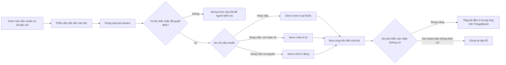

# Đề tài: Máy đếm, kiểm tra viên lỗi và phát hiện viên lạ bằng camera (bản demo với viên mô phỏng)

## 1. Máy làm gì?

Mỗi mẻ đếm gắn với **một loại viên chuẩn theo đơn**. Người vận hành chọn mẫu chuẩn và số viên cần lấy, chẳng hạn 10 viên. Camera kiểm tra từng viên có giống mẫu chuẩn và còn nguyên hay không. Máy đưa viên vào đúng **ba ô**: (1) **viên đúng, nguyên**; (2) **viên đúng loại nhưng sứt/mẻ/nứt/vỡ nhìn thấy được**; (3) **viên sai loại so với mẫu chuẩn của mẻ**. Ba cảm biến đường rơi xác nhận số lượng thực tế trước khi cộng bộ đếm. **ThingsBoard** hiển thị tiến độ, số viên từng ô, lỗi máy và thống kê mẻ; người vận hành gửi lệnh bắt đầu/tạm dừng/dừng từ dashboard.

**“Nhận diện” ở đây là đối chiếu viên với mẫu chuẩn của mẻ, không phải phân loại hỗn hợp nhiều thuốc vào nhiều khay.** Ví dụ mẻ đang đếm viên trắng tròn: viên trắng tròn nguyên vào ô đúng, viên trắng tròn bị vỡ vào ô hư, viên xanh bầu dục vào ô sai thuốc. Nếu viên lạ cũng vỡ, **ưu tiên ô sai thuốc** khi chắc chắn nó khác mẫu chuẩn. Nếu ảnh không đủ chắc chắn để quyết định giữa ba ô, **dừng máy trước khi thả để người vận hành xử lý**, không tự đẩy vào một ô rồi ghi nhãn tùy ý.

**Phạm vi 4 người trong 7 tuần:** dùng kẹo/viên giả làm một loại chuẩn, vài mẫu sứt/vỡ rõ và 1–2 loại viên lạ khác màu, kích thước hoặc hình dạng; **ba ô hứng**. Chạy chậm từng viên, dừng đĩa để chụp và đặt cửa phân luồng. Đây là nguyên mẫu kỹ thuật; **không dùng để nhận dạng, đếm hoặc cấp phát thuốc thật cho bệnh nhân**. Camera không xác định hoạt chất, không phát hiện chắc chắn nứt ở mặt dưới hoặc viên lạ có ngoại hình gần như giống hệt mẫu chuẩn.

**Khách hàng tiềm năng về dài hạn:** đơn vị đóng gói lại sản phẩm dạng viên, nhà thuốc hoặc khoa dược có quy trình cấp phát phù hợp. Muốn dùng trong thực tế phải kiểm chứng độ chính xác trên từng sản phẩm, vệ sinh vật liệu tiếp xúc, khả năng truy vết và quy trình kiểm tra của người có chuyên môn. Bản demo không chứng minh các điều kiện đó.

### Đã có sản phẩm hoặc nghiên cứu tương tự chưa?

**Có. Ý tưởng không mới trên thị trường; điểm đáng làm của đồ án là tích hợp đối chiếu viên với mẫu chuẩn, kiểm tra lỗi, cấp từng viên, phân luồng ba ô và xác nhận số viên thực sự rơi vào mỗi ô trong một nguyên mẫu nhỏ.**

| Nguồn | Họ đã làm gì? | Điều nhóm học được |
|---|---|---|
| [Eyecon 9430 và Optical Pill Verification](https://eyeconvpc.com/optical-pill-verification/) | Máy đếm bằng thị giác; phần mềm đối chiếu kích thước, hình dạng, màu và một số ký hiệu để cảnh báo vật khác thường cho người vận hành xem. | Nhận diện bất thường là bài toán có giá trị; **cảnh báo để người kiểm tra** khác với cơ cấu tự gạt từng viên. |
| [Hướng dẫn Eyecon 9420/9430](https://eyeconvpc.com/wp-content/uploads/Eyecon9420.9430_u_en_501651.pdf) | Hãng nói máy đánh dấu nhiều viên vỡ hoặc khác dạng, nhưng viên vỡ quá giống dạng chuẩn **vẫn có thể bị đếm**. Người dùng xử lý vật nghi ngờ trên khay. | Không hứa phát hiện 100% lỗi; cần trạng thái `không chắc` và kiểm tra thủ công. |
| [Kirby Lester KL1/KL1Plus, tài liệu Capsa](https://www.capsahealthcare.com/wp-content/uploads/2022/09/Capsa_PharmacyAutomation_N.America_Brochure_C-804.pdf) | Thiết bị đếm; KL1Plus thêm xác minh đơn, thuốc và số lượng theo quy trình của hãng. | Không suy luận rằng **mọi** máy đếm quang học đều xử lý viên vỡ giống nhau hoặc đều chỉ dùng một loại cảm biến. |
| [Nghiên cứu kiểm tra viên trong vỉ bằng thị giác](https://www.sciencedirect.com/science/article/abs/pii/S1077201403000184) | Phát hiện viên thiếu, vỡ, mảnh vụn, sai màu, kích thước và hình dạng trong một bối cảnh đóng vỉ. | Camera và ánh sáng ổn định là nền tảng; kết quả trên vỉ thuốc không chuyển nguyên sang đĩa quay của nhóm. |
| [Hệ thống kiểm tra viên trên máy đếm của True Care Technology](https://truecaretech.com/products/vision-inspection/tablet-capsule-online-verification-system) | Mô tả hệ thống thị giác kiểm tra lỗi khi đếm/chiết rót và loại sản phẩm sai. | Tự động loại là hướng đã được làm ở thiết bị công nghiệp; nhóm cần chứng minh cơ cấu đồng bộ và dữ liệu của **chính mẫu demo**. |
| [Jekson TIS Sorter](https://jeksonvision.com/products/tis-sorter/) | Thiết bị công nghiệp phân loại dựa trên đặc điểm nhìn thấy như màu, hình dáng, kích thước và lỗi vỡ. | Tham khảo cách tách viên bất thường; nhóm chỉ kiểm tra **một mẫu chuẩn cho mỗi mẻ**, cùng hai loại bất thường. |

## 2. Ảnh chụp linh kiện thật để nhận dạng

Các ảnh sau là **ảnh sản phẩm từ nhà bán hàng/nhà sản xuất**, không phải ảnh đồ nhóm đang có. Theo thông tin bạn vừa xác nhận, nhóm **đã có 28BYJ-48 và bo ULN2003**; đây là cặp motor/driver chính của thiết kế. Pi 4 và camera cũng đã có, còn phiên bản camera, nguồn và kích thước cơ khí cần đối chiếu với đồ thật. Phần đĩa có hốc, phễu và cửa phân luồng phải **tự gia công** theo kích thước viên mẫu.

| Linh kiện | Ảnh thật và dấu hiệu nhận ra | Vị trí, nhiệm vụ |
|---|---|---|
| Raspberry Pi 4 | <br>[Nguồn ảnh](https://www.pccomponentes.com/placas-base-raspberry-pi-placa-base-raspberry-pi-4-model-b-4gb-wi-fi-bluetooth-usb-3-0-gigabit-ethernet) — bo xanh, cụm cổng USB/Ethernet | Gắn ở **khoang điện riêng**, không nằm trên đường viên đi. |
| Camera Pi dạng CSI | <br>[Nguồn ảnh](https://vilros.com/products/raspberry-pi-camera-3) — bo nhỏ nối cáp dẹt | Ví dụ camera gắn **cố định trên vùng soi**; nếu camera sẵn có là webcam USB thì dùng giá khác. |
| **Motor 28BYJ-48 + bo ULN2003 (nhóm đã có)** | <br>[Nguồn ảnh và thông số](https://www.olimex.com/Products/Robot-CNC-Parts/StepperMotors/SM-5VDC-DRV/) — motor tròn nhỏ, đầu cắm 5 dây; bo driver có 4 ngõ IN | **Phương án chính:** ULN2003 điều khiển 28BYJ-48, kéo đĩa nhẹ quay chậm từng hốc. Dùng nguồn đúng phiên bản motor; đỡ trục đĩa bằng ổ đỡ riêng, không đặt toàn bộ tải lên trục motor. |
| Servo SG90 | <br>[Nguồn ảnh](https://thepihut.com/products/towerpro-servo-motor-sg90-analog) — vỏ xanh, tay đòn trắng | Bắt cố định dưới cửa thả, xoay ống dẫn nhẹ tới **ba vị trí**: đúng, hư, sai thuốc; cần hiệu chuẩn góc và thử độ rơ. |
| Cặp cảm biến chặn tia hồng ngoại | <br>[Nguồn ảnh](https://www.adafruit.com/product/2167) — hai đầu nhỏ đối diện nhau | Mỗi trong ba đường rơi cần một cặp để xác nhận viên đi qua. **Kiểm tra điện áp ngõ ra/pull-up trước khi nối GPIO Pi.** |
| Công tắc hành trình cần gạt | <br>[Nguồn ảnh](https://sklep.avt.pl/pl/products/przelacznik-krancowy-on-on-dzwignia-25mm-z-rolka-vs15n06-1c-174993.html) — thân nhỏ, cần gạt kim loại | Một chiếc ở đế làm **mốc gốc của đĩa**; công tắc khác có thể kiểm tra lọ đặt đúng chỗ. |
| Khớp nối hoặc truyền đai tới trục đĩa | [Ví dụ bộ đai và puly](https://www.leroymerlin.fr/produits/lot-2-poulies-gt2-alu-20t-5-mm-60t-8-mm-courroies-200-mm-96225802.html) | Chọn sau khi đo trục 28BYJ-48 và đĩa thật. Trục đĩa cần ổ đỡ riêng; nếu dùng đai, tránh căng quá làm motor nhỏ bị quá tải. |

**Các phần không thể chọn bằng ảnh bán hàng:** đĩa có hốc, phễu, tấm đáy giữ viên, cửa thả, ống dẫn xoay và ba máng, vỏ che sáng, ổ đỡ trục và giá camera. Phải đo **viên chuẩn, viên lạ thử nghiệm, motor/servo thật và khoảng cách camera lấy nét được** rồi mới vẽ/cắt chi tiết. Ảnh phối cảnh ở mục 3–4 giúp hình dung cách đặt tương đối, không thay bản vẽ gia công.

## 3. Phối cảnh lắp ghép với hình dạng linh kiện thực


**Đọc hình:** Pi 4 và driver ở khoang điện bên trái. Ở giữa là đĩa có hốc do motor bước kéo; camera và đèn phía trên chụp một hốc đã dừng. Bên phải, SG90 điều khiển **ống dẫn xoay ba vị trí** bên dưới cửa thả: lọ xanh **viên đúng**, khay cam **viên hư**, khay đỏ **viên sai thuốc so với mẫu chuẩn**. Mỗi đường có cảm biến quang. Camera, thân servo và ba ô đứng yên; đĩa và ống dẫn chuyển động.

**Ảnh là phối cảnh khái niệm, không phải ảnh máy đã lắp hay bản vẽ CAD.** Hình mới minh họa motor **28BYJ-48 tròn nhỏ và bo ULN2003** nhóm đang dùng; các chi tiết phễu, tấm đáy, ống dẫn, ổ đỡ và khớp truyền động vẫn phải đo/làm theo linh kiện thật. Ảnh không chứng minh lực kéo đĩa hoặc độ chính xác ba góc servo. Khi chạy thật cần che vùng đĩa và máng.

**Thứ tự lắp:** khung/đế → ổ đỡ, trục và đĩa có hốc với tấm đáy giữ viên → giá camera, đèn, vỏ che sáng → cửa thả → ống dẫn xoay và ba máng cố định. Motor kéo trục bằng đai/puly. Cửa thả nằm sau camera theo chiều quay; SG90 đặt ống dẫn vào vị trí **trước khi** viên rơi.

## 4. Phóng to đường đi của một viên


1. **Cấp hốc:** viên mô phỏng từ phễu vào một hốc; tấm đáy cố định giữ viên khi đĩa quay. Cần thử kích thước hốc với mẫu thật để hạn chế hai viên hoặc mảnh vụn đi cùng.
2. **Dừng chụp:** camera so viên với **mẫu chuẩn đang chọn cho mẻ**, kiểm tra sứt/mẻ/nứt/vỡ nhìn thấy được và hốc rỗng/nhiều vật. Hốc rỗng không tính. Nhiều vật hoặc ảnh không chắc thì dừng trước cửa thả để kiểm tra thủ công.
3. **Chọn ô:** `đúng mẫu + nguyên` → ô đúng; `đúng mẫu + hư` → ô hư; `khác mẫu rõ ràng` → ô sai thuốc, kể cả khi viên lạ bị vỡ. Servo đặt ống dẫn vào một trong ba góc đã hiệu chuẩn khi đĩa dừng.
4. **Thả và xác nhận:** đưa **cùng hốc đã chụp** tới cửa thả. Viên đi qua ống dẫn và máng tương ứng; cảm biến tại máng xác nhận rồi mới cộng bộ đếm **đúng/hư/sai thuốc**. Không thấy rơi hoặc thấy rơi sai máng thì dừng và báo lỗi.

Một camera trên cao chỉ quan sát **mặt đang hướng lên**. Vết nứt ở mặt dưới hoặc một loại thuốc khác có ngoại hình gần giống mẫu có thể bị bỏ sót. Ảnh cận cảnh là hình dựng để giải thích bố trí, không thay thử nghiệm cơ khí.



**Điểm quan trọng:** máy phân loại **ba kết quả trong một mẻ chỉ có một mẫu chuẩn**. Ưu tiên kiểm tra `khác mẫu` trước `hư` để viên lạ bị vỡ không chui vào ô viên chuẩn hư. Khi không chắc, máy dừng để người kiểm tra; ba ô là ba kết quả tự động, không có ô thứ tư ẩn. Servo chuyển ống dẫn trước khi thả; không giả định nó gạt kịp viên đang rơi trong 0,2 giây. Công tắc gốc xác định hốc số 0 khi khởi động.

**Vị trí nhìn từ trên:** phễu nạp → hốc dọc mép đĩa → camera/đèn cố định → cửa thả → ống dẫn xoay tới một trong ba máng. Ba ô đứng yên bên dưới. Không để nhựa in 3D chưa đánh giá vệ sinh tiếp xúc với thuốc thật.

## 5. Lắp các khối điện như thế nào?

```text
Camera CSI/USB ─────────────────────────> Raspberry Pi 4 ──MQTT──> ThingsBoard dashboard
Công tắc gốc + kiểm tra ba ô ─────────────────┤                   │
Ba cảm biến quang đường rơi ──────────────────┤<──── RPC bắt đầu / tạm dừng / dừng ────┘
                                              ├──> IN1–IN4 ──> ULN2003 ──> 28BYJ-48
                                              └──> tín hiệu servo ────────────────> SG90
Nguồn Pi riêng ───────────────────────────────> Pi 4
Nguồn motor đúng thông số ────────────────────> driver motor
Nguồn servo phù hợp ──────────────────────────> SG90
Nút dừng tại máy cắt nguồn truyền động; mass tín hiệu nối chung theo sơ đồ driver.
```

Pi **xử lý ảnh, quyết định phân luồng, điều khiển và đếm tại chỗ**; ThingsBoard nhận dữ liệu để hiển thị và gửi lệnh điều khiển. Nếu mạng mất, máy không được cộng số từ dashboard thay cảm biến và vẫn phải dừng an toàn bằng nút tại máy. Pi không cấp dòng motor/servo trực tiếp từ GPIO. **28BYJ-48 năm dây nối vào ULN2003 nhóm đã có**; ULN2003 dùng bốn tín hiệu `IN1–IN4` từ Pi và nguồn đúng phiên bản motor (kiểm tra nhãn motor, thường là 5 V). Không cần mua **DRV8825** để chạy cặp này; L298N cũng không cần cho motor này. Tín hiệu cảm biến 5 V không đưa trực tiếp vào GPIO Pi. Có thể thêm vi điều khiển nhỏ nếu Pi xử lý ảnh làm nhịp bước không ổn định.

**Liên động tối thiểu:** không xoay khi chưa tìm gốc; không thả khi thiếu ô đích; chỉ thả sau khi quyết định đủ chắc chắn và servo ổn định; dừng khi không thấy viên rơi hoặc rơi sai đường; không xử lý hốc tiếp theo trước khi hốc hiện tại xong. RPC từ ThingsBoard chỉ được thực hiện khi liên động tại máy cho phép.

## 6. Danh sách phần cứng và chi phí mua thêm

**Đối chiếu với đồ nhóm đã có:** Raspberry Pi 4 + camera làm xử lý ảnh và gửi ThingsBoard; **28BYJ-48 + ULN2003** quay đĩa; **SG90** xoay ống dẫn ba vị trí; **buzzer** báo lỗi. Động cơ DC + L298N có thể dùng *nếu* sau này cần rung/cấp liệu hỗ trợ, nhưng không thay motor bước định vị hốc hay servo chọn ba ô. Cảm biến siêu âm có thể thử đo mức viên trong phễu hoặc phát hiện **một** ô ở vị trí cố định; nó không thay được **ba cảm biến quang ở ba đường rơi**, vì không biết viên thật đã đi qua máng nào. DHT11 chỉ đo môi trường, không xác định viên hư hay sai thuốc; không cần đưa vào bản demo chính.

**Ảnh sản phẩm** là ảnh mẫu từ nhà bán hàng/nhà sản xuất, không phải ảnh linh kiện nhóm đang cầm. **Hình minh họa** là ảnh dựng để thấy hình dạng của cụm phải tự chế; kích thước, khớp nối và cách gắn vẫn phải đo trên đồ thật.


*Hình dựng bổ trợ cho các dòng tự gia công trong bảng; đọc từ trái sang phải, từ trên xuống.*

**Cột giá là chi phí mua thêm ước tính cho cả số lượng ở mỗi dòng, tính bằng đồng Việt Nam tại thời điểm viết (10/2026).** `0` nghĩa là nhóm đã có; `0 nếu tận dụng` phụ thuộc đồ dùng chung thực tế. Giá gia công/các vật liệu chưa chốt kích thước là **ngân sách dự trù**, không phải báo giá. Chưa tính công gia công và phí vận chuyển.

| Bộ phận | Hình dạng | Số lượng | Đã có / cần bổ sung | Giá mua thêm dự kiến | Chức năng và lưu ý |
|---|---|---:|---|---:|---|
| Raspberry Pi 4, nguồn Pi, thẻ nhớ | <br><small>Ảnh sản phẩm Pi 4</small> | 1 bộ | Đã có theo [sổ phần cứng chung](so-sanh-de-tai.md) | **0 đ** | Chạy camera, AI, MQTT, máy trạng thái. Kiểm tra lại nguồn/thẻ trước khi lắp. |
| Camera Pi hoặc webcam | <br><small>Ảnh sản phẩm Camera Pi mẫu</small> | 1 | Đã có | **0 đ** | Cố định ở vùng soi; thử lấy nét ở khoảng cách làm việc thật. |
| Đèn LED tán sáng + hộp che sáng | <br><small>Hình minh họa cụm đèn và chụp che sáng</small> | 1 bộ | Cần làm/mua | **50.000–150.000 đ** *(dự trù)* | Giữ màu/biên dạng nhất quán; có thể tận dụng đèn sẵn nếu thử ảnh đạt. |
| Phễu, đĩa có hốc, trục, ổ đỡ, vỏ che, vật liệu lắp ghép | <br><small>Hình minh họa đĩa có hốc và trục đỡ</small> | 1 bộ | Cần tự gia công | **150.000–350.000 đ** *(dự trù)* | Đĩa nhẹ, ổ đỡ riêng để 28BYJ-48 không gánh trọng lượng. [Mica 30 × 30 cm tham khảo](https://shopee.vn/%E2%9D%A4%EF%B8%8FB%E1%BB%99-1-t%E1%BA%A5m-mica-30x30cm-mica-trong-2mm-3mm-5mm-i.59504952.21020850546). |
| Motor 28BYJ-48 + driver ULN2003 | <br><small>Ảnh sản phẩm 28BYJ-48 và ULN2003</small> | 1 bộ | **Nhóm đã có** | **0 đ** | Quay từng hốc. Không cần DRV8825; thử tải thật trước khi đổi motor. |
| Công tắc hành trình tìm gốc đĩa | <br><small>Ảnh sản phẩm công tắc hành trình</small> | 1 | Cần mua nếu chưa có | **5.000–10.000 đ** | [Giá tham khảo 5.000 đ/cái](https://nshopvn.com/product/cong-tac-hanh-trinh-kw12/). Không thể lấy siêu âm thay mốc góc chính xác. |
| Servo SG90 + ống dẫn nhẹ, ba máng | <br><small>Hình minh họa servo và ba máng</small> | 1 bộ | Servo đã có; ống/máng tính trong phần cơ khí | **0 đ** *(servo)* | Chọn đúng/hư/sai thuốc; thử độ rơ ở cả ba góc. |
| Cảm biến quang chữ U hoặc cặp thu-phát phù hợp bề rộng viên | <br><small>Ảnh sản phẩm cặp cảm biến thu phát mẫu</small> | 3 | Cần mua | **27.000–60.000 đ** | [Mẫu chữ U 9.000 đ/cái](https://linhkienthuduc.com/san-pham/h2010-lm393-mach-cam-bien-quang-toc-do-dong-co-cai/); phải kiểm tra **khe có đủ rộng cho viên và máng**. Nếu không, dùng cặp thu-phát rời. Không nối đầu ra 5 V thẳng vào GPIO Pi. |
| Ba ô hứng và công tắc kiểm tra ô có mặt | <br><small>Hình minh họa ba ô hứng</small> | 3 ô + tối đa 3 công tắc | Có thể tận dụng hộp/lọ; công tắc cần mua nếu muốn kiểm tra từng ô | **15.000–90.000 đ** *(dự trù)* | Mỗi ô riêng; [công tắc mẫu 5.000 đ/cái](https://nshopvn.com/product/cong-tac-hanh-trinh-kw12/). Nếu tận dụng ô có sẵn, chỉ trả tiền công tắc. |
| Nút dừng tại máy + buzzer | <br><small>Hình minh họa nút dừng và buzzer</small> | 1 bộ | Buzzer đã có; kiểm tra nút dừng | **20.000–60.000 đ** *(dự trù nút/dây)* | Nút dừng truyền động tại máy; buzzer báo kẹt và sai đường. |
| Kết nối mạng Pi + ThingsBoard | <br><small>Ảnh dashboard ThingsBoard mẫu</small> | 1 | Pi dùng mạng sẵn có; chọn ThingsBoard CE cài tại chỗ nếu có máy chủ | **0 đ** *(không tính máy chủ/Internet)* | Dashboard, lịch sử và RPC; không cần mua bo Wi-Fi/ESP32 riêng cho Pi. |
| Nguồn cho motor/servo, dây, cầu chì | <br><small>Hình minh họa nguồn dây và cầu chì</small> | 1 bộ | Tận dụng nếu đã có nguồn 5 V đủ dòng/đúng cổng | **0–100.000 đ** | Nếu phải mua adapter riêng, [mẫu 5 V–2 A 55.000 đ](https://hntech.com.vn/cua-hang/nguon-adapter-5v-2a/); đo tải đồng thời của motor và servo trước khi chọn. Không cấp dòng motor từ GPIO Pi. |
| Kẹo/viên giả chuẩn, mẫu sứt/vỡ và viên lạ | <br><small>Hình minh họa viên mô phỏng</small> | 1 bộ | Cần chuẩn bị | **20.000–50.000 đ** *(dự trù)* | Chỉ dùng vật mô phỏng; không dùng thuốc cấp phát thật. |

**Tổng chi thêm sơ bộ: khoảng 287.000–870.000 đ** nếu tận dụng Pi, camera, 28BYJ-48 + ULN2003, SG90, buzzer và nguồn/đồ dùng chung đang có; cận trên gồm nguồn mới và nhiều vật liệu gia công hơn. Nên chốt kích thước đĩa, loại cảm biến quang và nguồn rồi mới lập giỏ mua hàng. **Không mua DRV8825, motor NEMA 17, L298N mới hoặc DHT11 cho bản demo này.**

## 7. AI và ThingsBoard nằm ở đâu?

- **Đầu vào AI:** ảnh một viên/hốc dưới ánh sáng cố định và **mẫu chuẩn được chọn trước cho mẻ**. Mẫu chuẩn là đặc điểm/ảnh tham chiếu của loại viên dự kiến, không phải bằng chứng về hoạt chất.
- **AI thị giác:** đánh giá `giống mẫu chuẩn?` và `có lỗi nhìn thấy?`. Quy tắc xuất ba kết quả: khác mẫu chắc chắn → **sai thuốc**; giống mẫu nhưng hư → **viên hư**; giống mẫu và nguyên → **viên đúng**. Nếu không chắc, dừng trước khi thả để người vận hành kiểm tra. Viên lạ không cần được đặt tên chính xác; chỉ cần nhận ra nó khác mẫu của mẻ.
- **Đối chứng không AI:** so màu, diện tích, chu vi và độ tròn bằng OpenCV/ngưỡng. Thu ảnh nhiều lượt và hướng viên; giữ tập thử độc lập. Báo tỷ lệ **lọt viên hư**, **lọt viên sai thuốc**, **loại nhầm viên đúng** và nhầm giữa hai ô bất thường.
- **Điều khiển:** motor, servo, cảm biến và bộ đếm là máy trạng thái, **không phải AI**. Chỉ đếm sau khi cảm biến đúng máng xác nhận. Không chắc hoặc cảm biến báo sai đường thì dừng.
- **ThingsBoard:** Pi gửi qua MQTT các telemetry như `good_count`, `damaged_count`, `foreign_count`, `target_count`, `machine_state`, `error_code`, `batch_id`, `cycle_time_ms`. Dashboard hiển thị ba bộ đếm, tiến độ mục tiêu, trạng thái, biểu đồ theo mẻ và cảnh báo kẹt/sai đường. RPC `start`, `pause`, `stop` gửi từ dashboard về Pi; Pi kiểm tra liên động và trả trạng thái thực tế. Ảnh trường hợp bất thường nên lưu cục bộ trên Pi; chỉ đưa mã sự kiện/đường dẫn tới dashboard nếu đã cấu hình nơi lưu ảnh truy cập được, tránh nhồi ảnh nhị phân vào telemetry.
- **Giới hạn:** ảnh không xác nhận thành phần hóa học, hoạt chất, hàm lượng, vết nứt mặt dưới hay viên lạ trông gần hệt mẫu chuẩn. Bản demo không thay kiểm soát nguồn viên và người có chuyên môn.

**Đếm thế nào cho đúng:** dự đoán ảnh chỉ chọn **máng dự kiến**. Bộ đếm `good_count`, `damaged_count` hoặc `foreign_count` tăng sau khi cảm biến **đúng máng** ghi một lượt rơi hợp lệ; sau đó Pi mới gửi giá trị mới lên ThingsBoard. Nếu không thấy rơi hoặc cảm biến máng khác báo, dừng và báo lỗi, không tự cộng. Mẻ dừng khi `good_count` đã xác nhận đạt chỉ tiêu.

**Giao tiếp ThingsBoard tham khảo:** [MQTT telemetry](https://thingsboard.io/docs/paas/reference/mqtt-api/telemetry/) dùng topic `v1/devices/me/telemetry`; [server-side RPC](https://thingsboard.io/docs/paas/reference/mqtt-api/rpc/) dùng `v1/devices/me/rpc/request/+` để nhận lệnh. Token thiết bị được cấu hình trên Pi, không ghi vào báo cáo hay mã nguồn công khai.

### Phần khó và rủi ro demo

| Rủi ro | Vì sao khó? | Cách thử/giới hạn trong 7 tuần |
|---|---|---|
| Hai viên hoặc hai mảnh cùng vào một hốc | Camera có thể thấy thành cụm; số đếm sai. | Thử kích thước hốc, nhận trạng thái nhiều vật và dừng. |
| Vết nứt nhỏ, mặt dưới bị che | Camera trên cao không nhìn thấy mọi lỗi. | Chỉ công bố lỗi nhìn thấy; thử xoay viên và báo tỷ lệ bỏ sót. |
| Viên lạ gần giống viên chuẩn | Màu/hình thay đổi theo ánh sáng và hướng. | Hộp che sáng; thử cả viên lạ rõ khác và gần giống, báo kết quả riêng. |
| Nhầm viên hư với viên sai thuốc | Viên lạ vỡ hoặc viên chuẩn sứt lớn có hình dạng khác. | Ưu tiên bằng chứng khác mẫu; ảnh không chắc thì dừng để kiểm tra, không ép vào một ô. |
| Servo lệch một trong ba vị trí hoặc viên kẹt | AI đúng nhưng vật lý vẫn cho sai ô. | Hiệu chuẩn ba góc; cảm biến cả ba máng; dừng khi sai đường. |
| ThingsBoard/mạng mất kết nối | Dashboard không phản ánh tức thời dù máy vẫn chạy. | Pi lưu trạng thái và bộ đếm tại chỗ; hiện trạng thái kết nối, đồng bộ lại khi có mạng; nút dừng tại máy luôn hoạt động. |
| Vượt chỉ tiêu mẻ | Viên tiếp theo tới cửa thả khi vừa đếm đủ. | Chỉ xử lý một hốc mỗi lượt, quay tiếp sau xác nhận rơi. |
| Tập lỗi ít, đánh giá sai | Accuracy chung cao vẫn có thể lọt lỗi hiếm. | Tập thử độc lập; báo tỷ lệ lọt viên hư/sai và loại nhầm. |

## 8. Việc cho 4 người và mốc 7 tuần

| Người | Phụ trách | Sản phẩm bàn giao |
|---|---|---|
| 1 | Cơ khí phễu, đĩa hốc, ổ đỡ, cửa thả, ống dẫn ba vị trí | Một viên qua từng hốc vào đúng một trong ba ô. |
| 2 | Motor, driver, công tắc gốc, servo, ba cảm biến rơi và nguồn | Đĩa dừng đúng; servo chọn trước khi thả; xác nhận rơi và dừng khi kẹt. |
| 3 | Camera, đèn, ảnh viên chuẩn/hư/sai, mô hình và đối chứng | Kết quả phát hiện hư/sai và loại nhầm trên tập thử độc lập. |
| 4 | ThingsBoard, MQTT/RPC, máy trạng thái, nhật ký và tích hợp | Dashboard ba bộ đếm, trạng thái, cảnh báo và lệnh start/pause/stop có phản hồi. |

| Tuần | Mốc bắt buộc |
|---|---|
| 1 | Chọn viên chuẩn, mẫu hư/sai; đo kích thước, kiểm kê motor/camera; thử hốc. |
| 2 | Đĩa quay và tìm gốc; camera chụp rõ hốc đứng yên. |
| 3 | Phễu cấp từng viên, ống dẫn ba vị trí và ba cảm biến chạy được **chưa cần AI**. |
| 4 | Thu/gán nhãn ảnh chuẩn/hư/sai; làm đối chứng và mô hình. |
| 5 | Ghép camera → servo → thả → cảm biến → bộ đếm; gửi telemetry ThingsBoard. |
| 6 | Thử RPC, cảnh báo và nhiều mẻ có viên hư/sai; đo số đếm sai và viên bất thường lọt. |
| 7 | Sửa lỗi lớn nhất, quay demo, báo cáo giới hạn và kết quả thực nghiệm. |

**Độ khó ước lượng:** cơ khí **8/10** vì phải đặt ống dẫn ổn định ở ba vị trí; AI **7/10** vì phân biệt viên hư và viên sai so với mẫu mẻ; tích hợp **8/10** vì phải khớp ảnh, servo, ba cảm biến và ThingsBoard. Trọng tâm đánh giá là **tỷ lệ lọt viên bất thường, loại nhầm viên đúng và đếm đúng sau khi thả**.

## 9. Trình tự demo trước hội đồng

1. Chọn một **mẫu viên chuẩn** và mục tiêu 10 viên đúng trên ThingsBoard. Nạp chủ yếu viên chuẩn, cố tình trộn vài viên cùng loại bị sứt/vỡ và 1–2 viên lạ. Đặt đủ ba ô.
2. Máy chụp từng viên, quyết định `đúng / hư / sai thuốc`; cảm biến xác nhận ô thực tế, ThingsBoard cập nhật ba bộ đếm, tiến độ và trạng thái. Thử lệnh tạm dừng/chạy tiếp từ dashboard.
3. Cho hốc trống, hốc có hai mảnh và một ảnh không chắc; máy phải dừng trước cửa thả để người xử lý. Lấy một ô ra để thử liên động. Thử nút dừng tại máy.
4. Sau khi dừng, **đếm thủ công** cả ba ô. Báo số viên hư/sai lọt vào ô đúng, viên đúng bị loại nhầm, nhầm giữa hai ô bất thường, chênh lệch bộ đếm và thời gian mẻ. Đối chiếu số trên ThingsBoard với bộ đếm cục bộ.

**Kết luận cần trình bày trung thực:** máy chứng minh nguyên lý **một mẫu chuẩn cho mỗi mẻ → cấp từng viên → kiểm tra hư/sai → phân luồng ba ô → cảm biến xác nhận → ThingsBoard giám sát/điều khiển**. Đây chưa phải thiết bị cấp phát thuốc đủ điều kiện sử dụng tại nhà thuốc hoặc lâm sàng.
